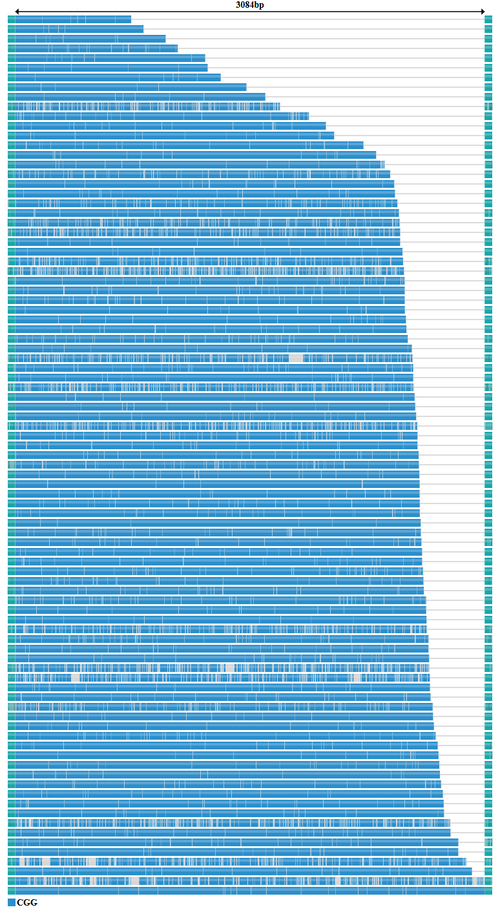
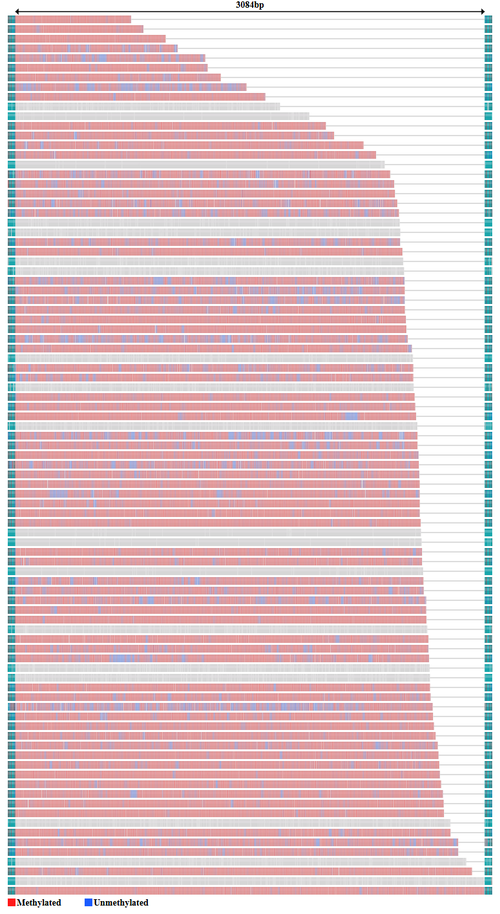
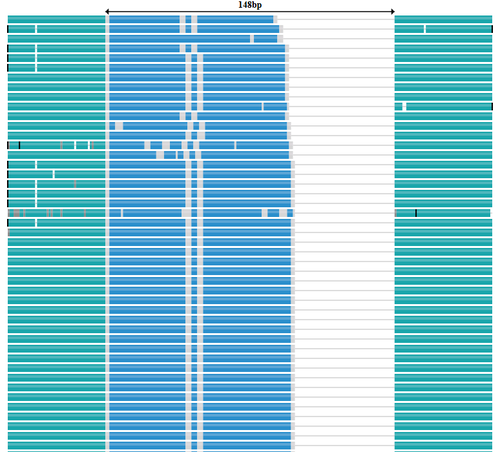
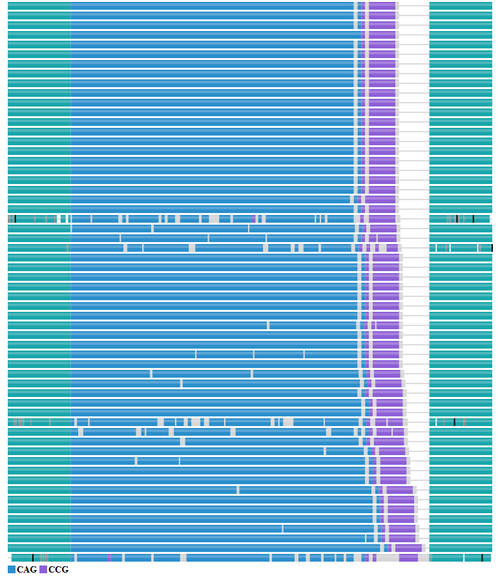
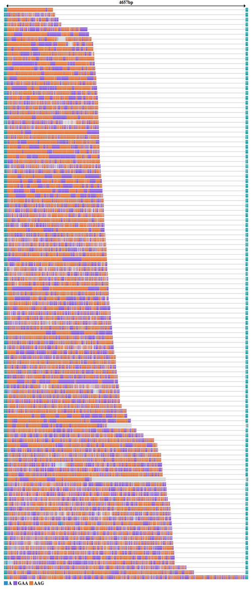

# Pathogenic repeat expansions in PacBio PureTarget long-read data

Genotyping, annotation and visual inspection of disease-causing tandem repeat expansions in 11 Coriell cell lines, using PacBio HiFi PureTarget data, **TRGT** and **Stranger**.

Course project, *Precision Medicine – Clinical Bioinformatics* (MSc Bioinformatics, IMC Krems, WS 2026/27).

## Why long reads

Most pathogenic repeat expansions are longer than a 150 bp short read, so short reads can't span them, measure them accurately, or show their sequence and methylation. PureTarget enriches the repeat loci with Cas9 **without PCR**, and PacBio HiFi reads span the whole repeat in one native molecule. Each read therefore gives the allele length, the motif structure (including interruptions) and the CpG methylation.

## Pipeline

```
aligned HiFi BAMs (GRCh38)
   │
   ├─ trgt genotype --preset targeted --karyotype XX|XY   ← STRchive catalogue (82 loci)
   │      → VCF (allele length, motif counts, purity, methylation) + spanning-read BAM
   ├─ bcftools / samtools sort + index
   ├─ stranger --trgt                                       ← disease thresholds (hg38)
   │      → STR_STATUS: normal / pre_mutation / full_mutation
   ├─ bcftools query  → table of expanded alleles
   └─ trgt plot --plot-type waterfall --show motifs|meth
```

| Step | Tool | Version |
|---|---|---|
| Genotyping, plots | [TRGT](https://github.com/PacificBiosciences/trgt) | 5.1.0 |
| Disease annotation | [Stranger](https://github.com/Clinical-Genomics/stranger) | 0.10.2 |
| BAM / VCF handling | samtools, bcftools | 1.25 |
| Repeat catalogue | [STRchive](https://strchive.org) hg38 TRGT catalogue | downloaded 2026-11-13 |

## Results

**12 non-normal alleles at 10 different loci** across the 11 samples (11 full mutations, 1 premutation):

| Sample | Locus | Disease | Status | Motif count | Allele length (bp) | Reads |
|---|---|---|---|---|---|---|
| sample01 | *ATXN3* | Machado–Joseph disease (SCA3) | full mutation | 69 | 217 | 238 |
| sample02 | *PABPN1* | Oculopharyngeal muscular dystrophy | full mutation | 13 | 40 | 329 |
| sample03 | *FMR1* | Fragile X syndrome | full mutation | 877 | 2,655 | 91 |
| sample04 | *ATN1* | DRPLA | full mutation | 71 | 221 | 105 |
| sample05 | *RFC1* | CANVAS | full mutation | 409 (AAGGG) | 2,086 | 26 |
| sample06 | *HTT* | Huntington disease | full mutation | 74 CAG + 8 CCG | 255 | 315 |
| sample07 | *DMPK* | Myotonic dystrophy type 1 | full mutation | 384 | 1,156 | 256 |
| sample08 | *FMR1* | Fragile X (premutation) | pre-mutation | 78 | 240 | 192 |
| sample09 | *AR* | Spinal and bulbar muscular atrophy | full mutation | 57 | 187 | 300 |
| sample10 | *FXN* | Friedreich ataxia (allele 1) | full mutation | 105 / 193 / 399 | 1,889 | 88 |
| sample10 | *FXN* | Friedreich ataxia (allele 2) | full mutation | 188 / 238 / 757 | **3,182** | 29 |
| sample11 | *ATXN1* | Spinocerebellar ataxia type 1 | full mutation | 43 | 133 | 228 |

The longest expansion (*FXN*, 3,182 bp) is about **21× the length of a 150 bp short read**. Full table: [`results/expanded_alleles.tsv`](results/expanded_alleles.tsv).

### What the reads show

| | |
|---|---|
|  |  |
| **FMR1 full mutation (sample03).** One allele (XY, chrX). Reads range from about 0.6 to 3 kb, showing somatic mosaicism. Without PCR, the spread is biological. | **Same allele, methylation.** The expanded allele is hypermethylated (red), the mechanism that silences *FMR1* in fragile X syndrome. |
|  |  |
| **ATXN1 (sample11), normal allele.** The grey columns in every read are protective CAT interruptions. The expanded allele is a pure, uninterrupted run. | **HTT (sample06), expanded allele.** 74 pure CAG, then the CAA/CCA interruptions and the CCG repeat (purple). |



**FXN (sample10).** Both alleles are expanded, as expected for the recessive Friedreich ataxia. The GAA/AAG colours are the same repeat in two frames, not interruptions.

Other observations:
- In the female FMR1 premutation sample (sample08), the expanded allele is methylated while the normal allele is not. This most likely reflects skewed X inactivation in the cell line, not premutation-driven silencing.
- `--karyotype` matters: XY samples get one (hemizygous) allele at chrX loci such as *FMR1* and *AR*.

Full-resolution SVG plots are in [`plots/`](plots/).

## Repository layout

```
├── scripts/run_pipeline.sh               end-to-end pipeline (genotype → annotate → table → plots)
├── notebook/repeat_expansion_analysis.ipynb   full report: commands, outputs, interpretation
├── results/expanded_alleles.tsv          main result table
├── plots/                                TRGT waterfall plots (SVG)
├── docs/img/                             PNG previews used in this README
└── environment.yml                       conda environment
```

## Reproduce

TRGT runs on 64-bit Linux only (on Windows, use WSL2).

```bash
conda env create -f environment.yml
conda activate trgt-course
# input layout: bam/sampleXX.bam(.bai), samples.tsv (sample<TAB>karyotype), ref/hg38.fa
bash scripts/run_pipeline.sh
```

The read data (PacBio public PureTarget repeat expansion panel data, Coriell cell lines, Revio) and the GRCh38 reference (`GCA_000001405.15_GRCh38_no_alt_analysis_set`, [NCBI](https://ftp.ncbi.nlm.nih.gov/genomes/all/GCA/000/001/405/GCA_000001405.15_GRCh38/seqs_for_alignment_pipelines.ucsc_ids/)) are not included in this repository because of their size.

## References

- Dolzhenko E. *et al.* Characterization and visualization of tandem repeats at genome scale. *Nature Biotechnology* (2024).
- Hiatt L. *et al.* STRchive: a dynamic resource detailing population-level and locus-specific insights at tandem repeat disease loci. *Genome Medicine* (2025).
- Stranger: https://github.com/Clinical-Genomics/stranger

